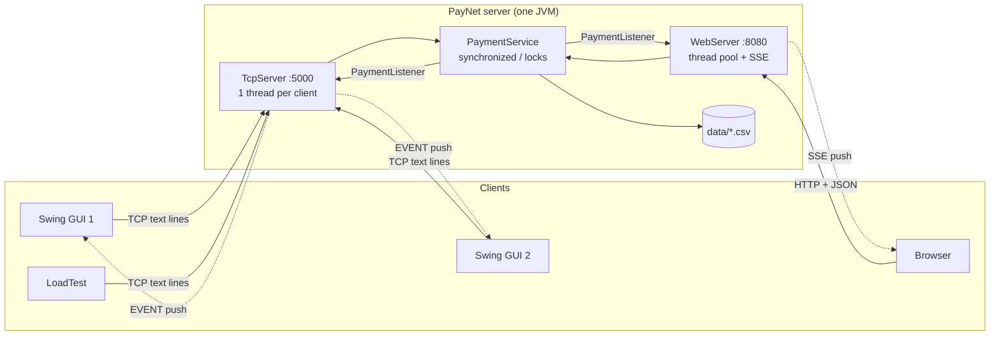

# PayNet Architecture

## Layers
1. **Presentation**: Swing client (`client`), website (`web/` in a browser).
2. **Network / protocol**: `TcpServer` (text protocol over TCP, port 5000) and `WebServer` (HTTP + JSON + SSE, port 8080).
3. **Business logic**: `PaymentService` (interface) and `PaymentServiceImpl`: accounts, sessions, atomic transfers, history, listeners.
4. **Persistence**: CSV files in `data/`.
5. **Common**: `Protocol` constants, `Transaction`, `Money`, `PayNetException` shared by client and server.

Both servers call only the `PaymentService` interface, so the rules are written once and a payment made in the
GUI shows up instantly on the website and vice versa (via `PaymentListener` callbacks).

## Diagram (Mermaid)


## Diagram (ASCII)
```
 +-----------+  +-----------+  +-----------+  +-----------+
 | Swing GUI |  | Swing GUI |  | LoadTest  |  |  Browser  |
 +-----+-----+  +-----+-----+  +-----+-----+  +-----+-----+
       | TCP text     | TCP text     | TCP text     | HTTP/JSON  ^ SSE
       v              v              v              v            |
 +----------------------------------------+  +------------------------+
 | TcpServer :5000                        |  | WebServer :8080        |
 | accept loop + 1 ClientHandler thread   |  | thread pool, REST+SSE  |
 | per connection (reads cmd, writes      |  | static files from web/ |
 | replies and EVENT pushes)              |  |                        |
 +--------------------+-------------------+  +-----------+------------+
                      \                                  /
                       v                                v
                 +--------------------------------------------+
                 | PaymentService (thread-safe business logic)|
                 | accounts, sessions, transfer(), history()  |
                 | listeners -> push events to TCP and SSE    |
                 +----------------------+---------------------+
                                        v
                                  data/*.csv
```

## Threads
- **main**: creates the service, starts both servers.
- **TCP accept thread**: blocks in `ServerSocket.accept()`, creates one handler thread per client.
- **ClientHandler threads**: each reads lines from its socket, calls the service, writes the reply. EVENT lines are written
  by the thread that performed the payment, so writes to a socket are synchronized to avoid interleaved lines.
- **Web threads**: HTTP requests are handled by a thread pool; each open SSE stream keeps one connection.
- **Client side**: the GUI has a reader thread (separates replies from EVENT lines) so the Swing event thread never blocks;
  UI updates go through `SwingUtilities.invokeLater`.

## Why these choices
- **TCP**: payments need reliable, ordered, error-checked delivery. UDP could lose or reorder a transfer message.
- **Thread per connection**: simple to understand and write for a student project, and blocking I/O keeps the protocol code
  readable. It scales to hundreds of clients; for thousands, NIO or thread pools would be used.
- **Shared service + synchronization**: all clients touch the same balances, so a transfer must lock both accounts
  (in a fixed order to avoid deadlock) so debit and credit happen as one atomic step.
- **SSE for the web**: the browser needs server-to-client push only. SSE is plain HTTP, works with the built-in
  `com.sun.net.httpserver`, reconnects automatically and is far simpler than WebSockets.
- **Text protocol**: easy to read, debug with telnet, and test with a few lines of code.
